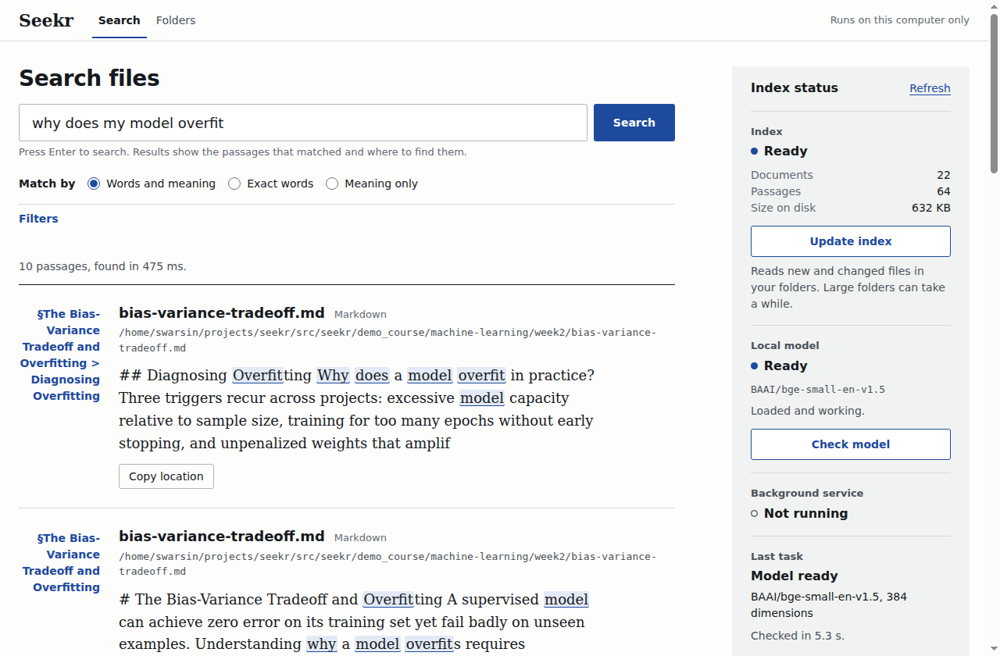

# seekr

Private, offline hybrid keyword and semantic search for your notes, PDFs, code, and lecture transcripts — stored in a single SQLite file on your machine.

[](https://github.com/Swarsin/seekr/actions/workflows/ci.yml)
[](https://pypi.org/project/seekr-search/)
[](https://pypi.org/project/seekr-search/)
[](LICENSE)


## Quickstart

Requires Python 3.11+ on Linux with SQLite loadable extension support. Note that the PyPI distribution name is `seekr-search`, while the command, Python import name, and config/data directories stay `seekr`.

```bash
# 1. Install the CLI and runtime dependencies
pipx install seekr-search

# 2. One-time model cache (seekr itself never downloads models implicitly)
~/.local/pipx/venvs/seekr-search/bin/python -c 'from sentence_transformers import SentenceTransformer; SentenceTransformer("BAAI/bge-small-en-v1.5")'

# 3. Index a folder and search immediately
seekr index ~/notes && seekr search "how do I checkpoint a WAL database?"
```

Run `seekr doctor` to verify SQLite FTS5/`sqlite-vec` support, add persistent folders in `~/.config/seekr/config.toml` (`roots = ["~/notes"]`), or cache `cross-encoder/ms-marco-MiniLM-L-6-v2` if you want optional `--rerank` scoring.

## What it does

- **CLI (`seekr`)** — index directories incrementally (`seekr index`, `seekr reindex`, `seekr status`), run hybrid/keyword/vector queries with `--kind`, `--since`, `--path`, `--rerank`, `--json`, and `--explain`, find related files (`seekr similar`), open hits interactively (`seekr pick`, `seekr open`), and generate shell completions (`seekr completion bash|zsh|fish`).
- **Web UI (`seekr web`)** — local-only browser workspace (`http://127.0.0.1:8000`) for adding folders, checking local model readiness, triggering incremental index scans, and searching with filters and one-click location copying. See [`docs/web.md`](docs/web.md) and [`docs/web-api.md`](docs/web-api.md).
- **Daemon (`seekr daemon`)** — keeps the embedding model warm in memory, answers CLI/web queries over `$XDG_RUNTIME_DIR/seekr.sock` (falling back automatically to local search when stopped), and watches configured roots for file changes; includes [`contrib/seekr.service`](contrib/seekr.service) (systemd user unit) and [`contrib/seekr-popup.sh`](contrib/seekr-popup.sh) (Hyprland/rofi launcher).
- **MCP (`seekr mcp`)** — newline-delimited JSON-RPC 2.0 stdio server exposing `search` and `similar` tools for coding agents with zero implicit network calls and stderr-only diagnostics.



## Use with Claude Code / Cursor

Register `seekr` in Claude Code with one command:

```bash
claude mcp add seekr -- seekr mcp
```

Or add the stdio MCP server block to Claude Desktop, Cursor, or any MCP host configuration:

```json
{
  "mcpServers": {
    "seekr": {
      "command": "seekr",
      "args": ["mcp"]
    }
  }
}
```

If `seekr` is installed inside a dedicated virtualenv (such as `pipx`), set `"command"` to `~/.local/bin/seekr` or that environment's `seekr` binary. The server exposes `search` (`query`, `k`, `mode`, `per_file`, `rerank`, `path`, `kind`, `since`, `explain`) and `similar` (`path`, `k`, `per_file`, `path_prefix`, `kind`, `since`).

## How it works

```text
PDF / Markdown / text / code / transcripts (UTF-8, UTF-8/UTF-16 BOM, latin-1 fallback)
                  │
                  ▼
        extract text units + locators
                  │
                  ▼
  chunk: word windows (300/450/50), heading sections,
  tree-sitter AST chunks, transcript cues
                  │
                  ▼
  batched embed locally (BAAI/bge-small-en-v1.5, 384-d L2-normalised,
  int8 quantized by default in sqlite-vec)
                  │
                  ▼
        one SQLite WAL index (schema v2)
        ├── documents (indexed on kind, mtime_ns) + chunks + meta
        ├── chunks_fts (external-content FTS5, porter unicode61)
        └── chunks_vec (sqlite-vec vec0 KNN + scalar filters)
                  ▲
                  │
query ──► BGE query prefix + embed locally
          ├──► FTS5 BM25 (path/kind/since SQL filters) ──┐
          └──► vec0 KNN or filtered scalar L2 search ────┴──► RRF (k=60)
                                                                 │
                                                                 ▼
                                                      optional cross-encoder rerank
                                                                 │
                                                                 ▼
                                         CLI (text / --json / --explain),
                                         warm Unix daemon, or `seekr mcp`
```

Indexing runs in batches (up to 64 files / 128 chunks per transaction) and keys each chunk by the SHA-256 of its normalised text, so unchanged passages reuse stored vectors across edits and renames. Configuration lives at `$XDG_CONFIG_HOME/seekr/config.toml` (`roots`, `db_path`, `ignore_globs`, `embed_model`, `rerank_model`, `vector_quant`), and `schema_version = 2` migrates legacy `float32` databases inside an atomic transaction. Once models are cached locally, `seekr.offline` sets `HF_HUB_OFFLINE=1` and `TRANSFORMERS_OFFLINE=1`, passes `local_files_only=True`, disables telemetry, and rejects `trust_remote_code`; network access is strictly limited to explicit BEIR dataset converters in `eval/beir_*.py` unless invoked with `--no-download`.

## Benchmarks

- Hybrid retrieval achieves the best 3-dataset macro-average `ndcg@10` across BEIR SciFact, NFCorpus, and FiQA (`0.4847` vs `0.4176` keyword and `0.4827` vector).
- Default `int8` quantization halves index DB size (`22.35 MiB` vs `44.88 MiB` at 20k chunks) with negligible quality change (`-0.06` pts macro-avg on SciFact+NFCorpus).
- Warm hybrid search runs at ~`11 ms` p95 (`11.39 ms` at 20k chunks, excluding query embedding).

See [`docs/benchmarks.md`](docs/benchmarks.md) for full BEIR tables, single-variable ablations, latency/throughput numbers, 100k-chunk scale results, and design notes, and [`docs/eval.md`](docs/eval.md) to evaluate your own corpus.

## Limitations

- No OCR for scanned image PDFs (extracts embedded text only).
- Linux only (`AF_UNIX`, `SO_PEERCRED`, and `fcntl.flock` lifecycle locks); Windows and macOS are not supported.
- No LLM answer generation — seekr retrieves and locates source passages rather than synthesizing prose answers.
- `OR`-joined multi-term FTS5 queries scan long posting lists on large conversational corpora (e.g., FiQA `keyword p50 = 72.13 ms`).
- Filtered vector queries (`--path`, `--kind`, `--since`, `seekr similar`) use sqlite-vec's exact `vec_distance_L2` scalar scan so filters apply before top-k selection, scaling linearly with matching chunk count.
- Transcript locators format timestamps in `open` links as labels without seeking external media players.

## Development

```bash
pip install -e ".[dev]"
ruff check .
pytest -m "not slow"
pytest -m slow          # real cached models, sqlite-vec int8, and 100k scale test
```

CI ([`.github/workflows/ci.yml`](.github/workflows/ci.yml)) runs `ruff check .`, `pytest -m "not slow"`, and wheel installation checks on Python 3.11–3.13 on Ubuntu.

## License

MIT. See [`LICENSE`](LICENSE).
